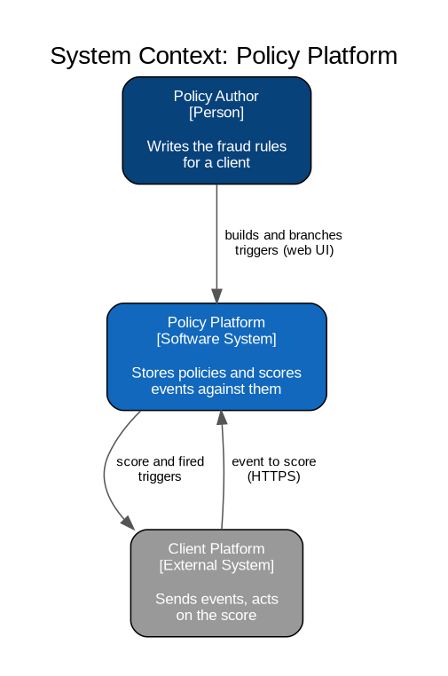
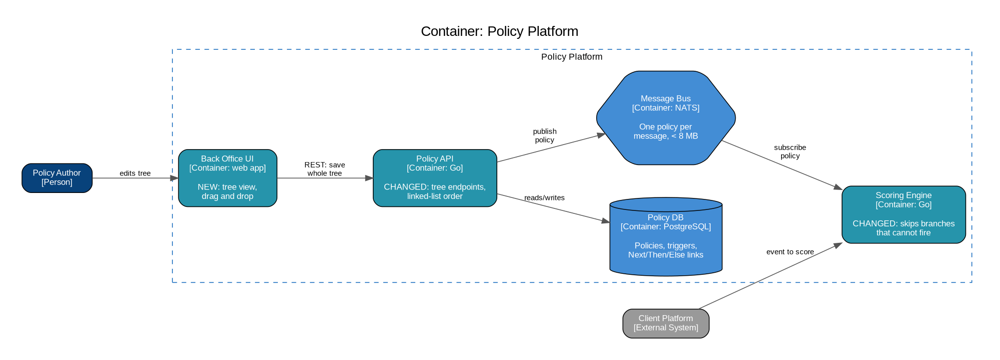
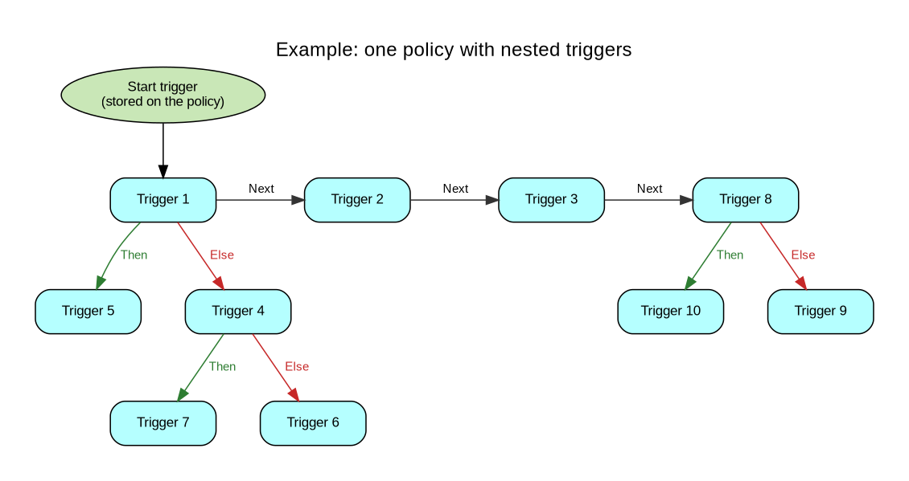
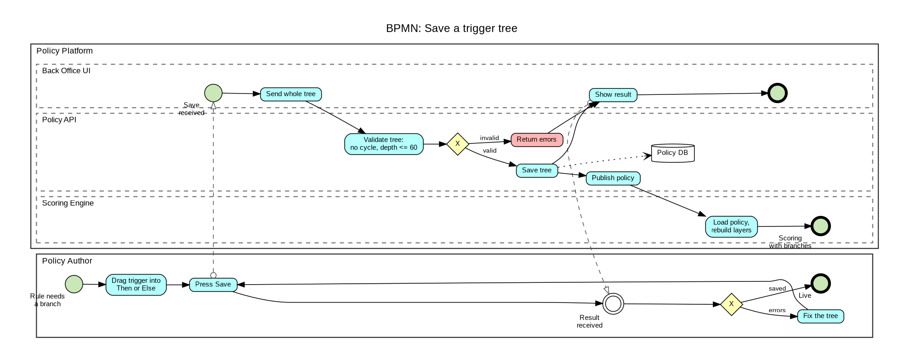
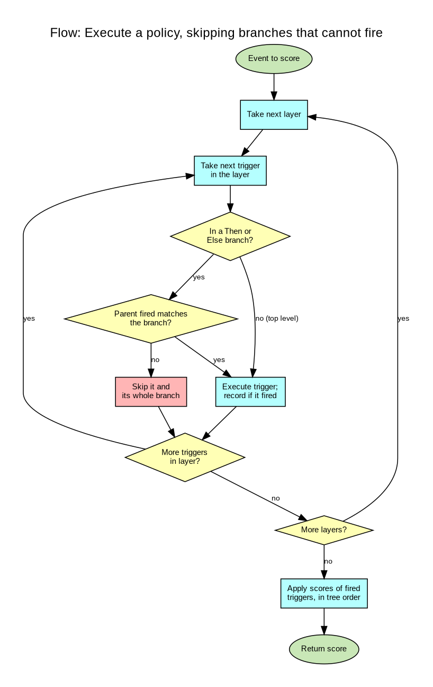

# AIC Example

**Reviewed**: 2026-10-16

A finished AIC written on [AIC Template.md](AIC Template.md), for reading before writing one. It is adapted from a real initiative in a fraud-scoring product, with names changed. Copy the shape, not the content: the depth of the Solution part depends on the initiative.

What to notice:

- Goals fit on one screen. Quality goals are three names, and one carries a reason because it is not plain.
- Every expected diagram is there, and the text under each adds only what the picture cannot show.
- Each hypothesis is short and written in its own shape. None repeats Context, Decision, Justification, Trade-offs labels.
- The skip rule is shown as a table and a worked example, not described in prose.
- Nothing in the body is rejected or superseded. The one rejected option a reader would ask about gets one line.

The images are in [images/aic-example/](images/aic-example/), each `.png` next to its `.dot` source. In a real initiative they sit in `docs/aics/<slug>/images/`.

---

# Nested Triggers

> Let a policy author branch fraud rules, so a trigger runs only when another trigger fired (Then) or did not fire (Else).

## [Goals](https://canvas.arc42.org/architecture-inception-canvas)

### 🟢 Business Case

A policy is a list of triggers, and every trigger runs on every scored event. Authors cannot say "check this only if that fired". Expression functions such as `coalesce` cannot run another trigger with a complex rule inside. So authors copy the parent's condition into each child trigger, and a change to one condition means editing every copy by hand. That is slow, and a missed copy changes fraud decisions without anyone noticing.

### 🟢 Functional Overview

- Branch a policy: a trigger can have a Then branch, which runs when it fires, and an Else branch, which runs when it does not.
- Build and rearrange the tree visually, by dragging a trigger into another trigger's Then or Else.
- Copy and paste a branch together with every trigger nested in it.
- A nested trigger is an ordinary trigger: same editor, same rules, same reports.

Not on the box: creating a trigger without leaving the tree view, undo and redo, and using one trigger in two branches.

### 🟢 Quality Goals

1. Usability
2. Safety: a wrong branch silently changes production fraud decisions.
3. Maintainability

### 🟢 Organizational Constraints

Not applicable: built by the existing policy team within its normal release process.

### 🟢 Technical Constraints

- The organization's [Engineering Principles](../../policy/references/Engineering%20Principles.md).
- Reuse the existing trigger entity and the layered execution tree of the Scoring Engine. No separate "nested trigger" entity.
- A policy travels from the Policy API to the Scoring Engine as one message on the bus, and NATS refuses a message over 8 MB.

### 🟢 Business Context

- The **Client Platform** changes nothing: it gets the same score, and the list of fired triggers simply includes nested ones.

## [Solution](https://canvas.arc42.org/architecture-inception-canvas)

### 🔵 Architectural Hypotheses

**H1. A nested trigger is a trigger with a parent.** Every trigger gains two optional links, Then and Else, each pointing at the first trigger of that branch. The editor, validation, reports and scoring keep working on one kind of object. A separate nested-trigger entity was rejected, because every one of those would need a second code path.

**H2. Order is a linked list, not a number.** Each trigger points to the next one (`NextTriggerID`), and the policy stores its start trigger. Dragging a trigger then changes three links instead of renumbering every trigger after it. The cost is a one-off migration from `Order` to `NextTriggerID`, and the old `/update-order` endpoint is retired.

**H3. Scoring skips a branch that cannot fire.** A branch whose parent result rules it out is never executed, so a policy with deep branches costs less to score than the same rules written flat.

**H4. A tree is checked whole, when it is saved.** The author edits freely; Save sends the whole tree and the Policy API refuses it on a cycle or on nesting deeper than 60. Checking each drag on its own was not chosen, because a half-finished edit is often briefly invalid.

### 🔵 Solution Design

Three containers change, and none is new. The Back Office UI gains the tree view, the Policy API stores links instead of positions, and the Scoring Engine learns to skip branches.

**A policy is a tree.** The top level is the chain of Next links; each trigger can open a Then and an Else branch, and branches nest.

The main list in the UI shows only the top level: Trigger 1, 2, 3 and 8. Opening a trigger shows its branches, and opening a branch goes one level deeper. A trigger can move between any two places, for example Trigger 4 out of the Else of Trigger 1 and in between Trigger 2 and Trigger 3.

**Saving a tree.**

A move is valid only when the trigger moved is not an ancestor of the place it is dropped, so a branch never contains itself. The Policy API checks that, and the depth limit, over the whole tree before writing anything.

**Scoring with branches.** The Scoring Engine runs triggers in layers: a trigger runs in a later layer than everything it depends on. A nested trigger now depends on its parent, so the parent's result is known when the child's turn comes. Before running a nested trigger the engine decides whether to skip it:

| Parent fired | Branch | Child runs |
| --- | --- | --- |
| yes | Then | yes |
| yes | Else | no, skipped with its whole branch |
| no | Then | no, skipped with its whole branch |
| no | Else | yes |

With the tree above, an event on which Trigger 1 fires runs Trigger 5 and never touches Trigger 4, 6 or 7.

**API changes in the Policy API**, all described in its OpenAPI (Swagger) file:

| Endpoint | Change |
| --- | --- |
| Get the tree of a policy | New. Returns every trigger with its Next, Then and Else links. |
| Triggers allowed at a position | New. Excludes the ancestors of that position. |
| Validate a tree | New. Cycle check and depth limit. |
| Save a tree | New. Validates first, then writes the whole tree. |
| Create and update a trigger | Accept Next, Then and Else. |
| `/update-order` | Deprecated, removed after the UI moves to Save a tree. |

**Delivery order.**

1. Scoring Engine: the parent dependency and the skip rule. It ships first, so it can run branched policies before any exist.
2. A maintenance page in the Back Office, switched on for the migration.
3. Migrate `Order` to `NextTriggerID`, and add the start trigger to every policy.
4. The tree endpoints, the tree view, drag and drop, and the Save button.
5. Rewrite the scoring tests that build triggers.

## [Assessment](https://canvas.arc42.org/architecture-inception-canvas)

### 🔴 Technical Challenges & Risks

| Risk | Likelihood | Impact | Mitigation |
| --- | --- | --- | --- |
| Deep trees are hard to edit on screen. | High | Medium | Reduce by design: the main list shows only the top level, and branches open one level at a time. Agreed with the frontend lead. |
| A policy grows past the 8 MB bus limit once branches multiply. | Low | High | Detect: the Policy API measures each policy's size on save. Policies are published one per message, never batched. |
| Scoring runs a half-migrated policy during step 3. | Medium | High | Reduce by design: the maintenance page blocks edits, and the Scoring Engine ignores `Order` from step 1 on. |

### Open questions

| Question | Who answers | By when (phase or stage) |
| --- | --- | --- |
| Is 60 the right depth limit, or should it come from the deepest real policy? | Product owner | Before delivery step 4 |
| Should one trigger be usable in two branches? | Product owner | Next stage, on a client request |
