# Diagram Conventions

**Reviewed**: 2026-10-16

**Purpose**: The single home for how initiative diagrams are produced, named, and colored. Applies to every notation in this library: C4, UML, BPMN, flowcharts, and the diagrams embedded in an arc42 document.

This file holds the shared rules plus the DOT templates for UML, BPMN, and flowcharts. C4 keeps its own templates in `C4.md` and ArchiMate keeps its own in `TOGAF.md`, because both are also `/arcdlc:aic` output formats.

---

## File Convention

All diagrams live in the `images/` folder inside the initiative directory, in **dual format**: the DOT source is committed next to the compiled image, so a diagram is always editable rather than redrawn.

1. Write DOT source: `images/<name>.dot`
2. Compile: `dot -Tpng images/<name>.dot -o images/<name>.png`
3. Embed in docs: ``

**Naming**: lowercase, underscores, descriptive, prefixed by notation.

| Notation | DOT source | Embed form | Examples |
|----------|------------|------------|----------|
| C4 | `images/c4_<level>_<name>.dot` | `` | `c4_context`, `c4_container`, `c4_component_list_manager`, `c4_dynamic_upload`, `c4_deployment_prod`, `c4_landscape` |
| UML | `images/<type>_<name>.dot` | `` | `component_lists`, `sequence_upload`, `state_list_sync`, `deployment_k8s`, `usecase_lists`, `class_domain`, `activity_cbf_rebuild` |
| BPMN | `images/bpmn_<process_name>.dot` | `` | `bpmn_order_intake`, `bpmn_list_approval` |
| Flowchart | `images/flow_<name>.dot` | `` | `flow_request_validation`, `flow_cbf_rebuild`, `flow_list_entry_routing`, `flow_migration_procedure`, `flow_error_handling` |
| ArchiMate (TOGAF) | `images/archimate_<layer>.dot` | `` | `archimate_business`, `archimate_application` |

- C4 `<level>`: `context`, `container`, `component`, `code`, `dynamic`, `deployment`, `landscape`.
- UML `<type>`: the diagram type — `component`, `sequence`, `state`, `deployment`, `usecase`, `class`, `activity`.

**Tooling**:

- **Graphviz DOT, for every notation in this library.** It compiles to PNG, it lays a graph out by
  rules rather than by guesswork, and a model writes it reliably. Probe once with `command -v dot`.
  When it is missing, write the `.dot` source anyway, tell the engineer to install Graphviz
  (`apt install graphviz`, `brew install graphviz`), and leave the image link in place for the
  compile.
- **A sequence diagram may be inline ASCII** in the document, with no image file, because DOT has no
  sequence notation. PlantUML is fine instead when `command -v plantuml` finds it; keep its `.puml`
  source next to the PNG the same way.
- **Mermaid only when the engineer asks for it.** Generated Mermaid often fails to compile or draws
  crossing, overlapping lines, and it does not produce a PNG without extra tooling. When the engineer
  does ask, keep the diagram under 15 nodes and compile it before saving.
- **draw.io for a diagram people maintain by hand.** When an engineer wants to refine a diagram in
  an editor rather than in DOT, convert it once to `images/<name>.drawio.svg`: an SVG with the
  draw.io XML embedded, so GitHub shows it as a picture and draw.io (or its VS Code extension) opens
  it for editing. Convert with `graphviz2drawio images/<name>.dot -o images/<name>.drawio`, open it
  in draw.io, export as SVG with "Include a copy of my diagram" on, and embed it as
  ``. From then on the `.drawio.svg` is the source; delete the
  `.dot` and `.png` so two copies cannot drift. Never write draw.io XML by hand or generate it from
  scratch: it holds absolute coordinates, so the layout would be guessed, which is the failure DOT
  avoids. Save it uncompressed so it diffs in git.

---

## Color Palettes

Two palettes are in use and they are **not interchangeable**. Choose by the **notation of the diagram, not by the document it appears in**: a C4 diagram keeps the C4 palette even inside a flowchart-heavy document, and a UML, BPMN, or flowchart diagram keeps the shared pastel palette even inside a C4-heavy document. Never mix the two inside one diagram.

### C4 diagrams — blue element family

**Applies to C4 diagrams only** (context, container, component, code, dynamic, deployment, landscape). Color encodes the *role* of the element.

| Element | Hex | Usage |
|---------|-----|-------|
| Person | `#08427B` | Dark blue, white text |
| Your System / Container | `#1168BD` / `#438DD5` | Blue family, white text |
| New Container | `#2694AB` | Teal, white text — highlights new additions |
| Component | `#85BBF0` | Light blue, black text |
| External System | `#999999` | Grey, white text |
| Deprecated | `#FFB5B5` | Red-tinted, black text |
| Infrastructure Node | `#C9E7B7` | Green (matches ArchiMate Technology layer) |
| System Boundary | `#1168BD` border | Dashed cluster outline |

### UML, BPMN, and flowchart diagrams — shared pastel palette

**Applies to UML, BPMN, and flowchart diagrams.** Color encodes the *kind of step*.

| Element | Color | Hex | Usage |
|---------|-------|-----|-------|
| Start / Success | Pale green | `#C9E7B7` | Entry points, successful outcomes |
| Process step | Pale cyan | `#B5FFFF` | Normal processing steps |
| Decision | Pale yellow | `#FFFFB5` | Decision diamonds, gateways |
| Error / End (failure) | Pale red | `#FFB5B5` | Error states, failure exits |
| Data store | Pale cyan | `#B5FFFF` | Database, file storage |
| Annotation | White | `#FFFFFF` | Comments, notes |

### Reading the overlap

- Two hexes appear in both palettes with different meanings: `#C9E7B7` (C4: infrastructure node — shared: start/success) and `#FFB5B5` (C4: deprecated — shared: error/failure). Interpret them in the palette of the diagram's notation.
- One deliberate crossover: UML use-case diagrams color external actors with the C4 person and external-system hexes (`#08427B`, `#999999`) so actors read the same across notations — see the use case template below.
- ArchiMate diagrams use a third, layer-based palette that stays with its notation in `TOGAF.md` (`## ArchiMate Diagram Conventions`).

---

## Choosing a notation

Draw by default. A reader takes in a picture faster than the paragraph that describes it, so where a
diagram can show it, draw it, and let the text add only what the picture cannot: the reason, a
number, an edge case. Every AIC carries three: a C4 system context diagram, a C4 container diagram,
and a flowchart or BPMN diagram of the main process (see `AIC Template.md`). Draw more wherever a
paragraph is explaining structure, order, branching, or state. Pick by what you need to show:

| You need to show | Draw |
|---|---|
| High-level services or modules | C4 container or component (`C4.md`) |
| Infrastructure and deployment | C4 deployment, or a UML deployment diagram |
| Domain types and their relationships | class diagram |
| How components interact in one scenario | sequence diagram (ASCII inline is fine) |
| A workflow with decisions or parallel paths | activity diagram, or BPMN when roles matter |
| An entity's lifecycle | state machine |
| What actors can do | use case diagram |
| A business process with roles, events, and handoffs | BPMN |
| A procedure, an algorithm, or error handling | flowchart |
| Enterprise layers | ArchiMate (`TOGAF.md`) |

BPMN over an activity diagram when the process crosses roles or waits on external events; activity
diagram when it is one system's internal logic.

---

## Look at every picture before you save it

A diagram that compiles can still be unreadable. After `dot -Tpng`, open the PNG and look at it,
every time. Redraw it when:

- an edge crosses a label, a node, or another edge where it does not have to,
- a label is clipped, overlaps something, or sits far from the edge it names,
- a node has no edge, or a path stops without an end,
- text is too small to read at the width the document shows it,
- one diagram tries to show two things: split it.

What usually fixes it, in this order:

1. Fewer nodes. One diagram holds one idea, at most about 15 nodes.
2. Short labels: four words or fewer per line, broken with `\n`.
3. The right direction: `rankdir=LR` for a pipeline or a BPMN process, `TB` for a hierarchy or a
   flowchart.
4. Pin what belongs together with `{ rank=same; a; b }`, and add `ordering=out` when the order of
   children matters, as in a tree with Then before Else.
5. `constraint=false` on a back edge or a loop, so it stops stretching the layout.
6. More room: raise `nodesep` and `ranksep`.

Avoid `splines=ortho` with edge labels: Graphviz drops or misplaces the labels. Compile with
`-Gdpi=110` or higher so the text stays sharp.

---

## UML templates

Component, activity, state machine, use case, and class. Sequence diagrams are usually clearer as inline ASCII than as DOT.

### Component Diagram

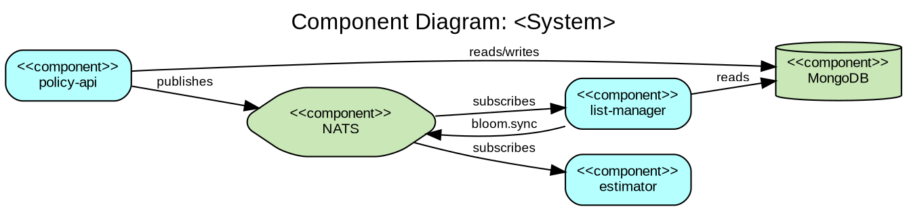

### Activity Diagram

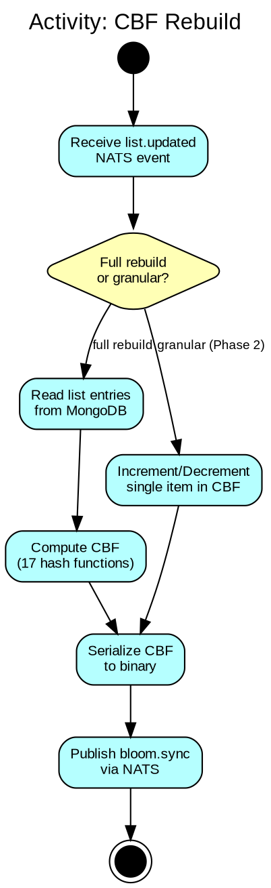

### State Machine Diagram

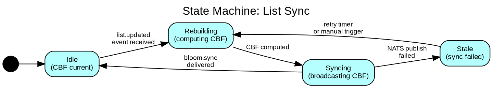

### Use Case Diagram

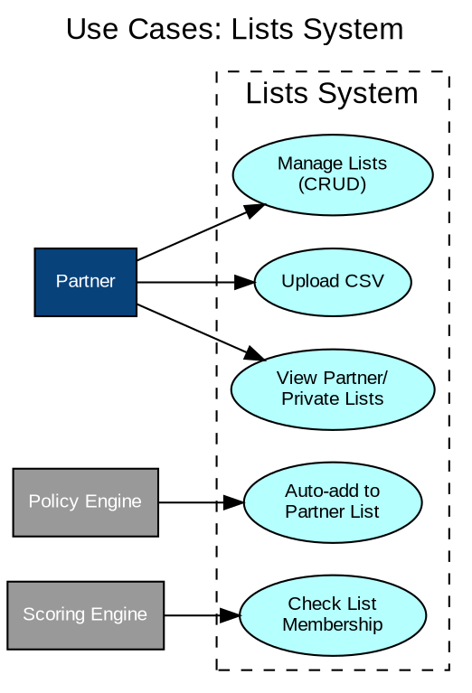

### Class Diagram (Go Adaptation)

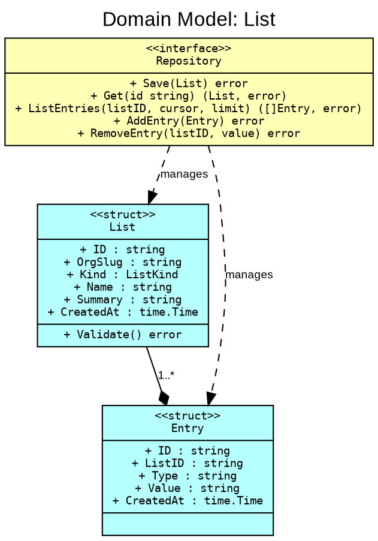

---

## BPMN templates

BPMN (Business Process Model and Notation) 2.0 shows a process that passes between people,
organizations and systems. A box-and-arrow drawing with swimlanes is not BPMN. The shapes below are
what make it BPMN, because each one means one thing to anyone who knows the notation.

### Elements and their DOT form

| BPMN element | Meaning | DOT |
| --- | --- | --- |
| Pool | A participant with its own process: a company, a person outside the organization, a system you do not own | `subgraph cluster_<name>`, `style=solid penwidth=1.5` |
| Lane | A role or a system inside one pool | a cluster nested in the pool, `style=dashed` |
| Start event | Where a process begins | `shape=circle width=0.35 fixedsize=true`, `#C9E7B7` |
| Intermediate event | Something that happens mid-process: a message arrives, a timer runs out | `shape=doublecircle width=0.3 fixedsize=true`, white |
| End event | Where a path ends | `shape=circle penwidth=4`, `#C9E7B7` for success, `#FFB5B5` for failure |
| Task | One unit of work, its type on the first line | `shape=box style="rounded,filled"`, label `<<User Task>>\nReview request` |
| Sub-process | A task with a process inside it | a task with `[+]` at the end of its label |
| Exclusive gateway (XOR) | Exactly one path is taken | `shape=diamond fixedsize=true`, label `X`, `#FFFFB5` |
| Parallel gateway (AND) | All paths run; a join waits for all of them | the same diamond, label `+` |
| Inclusive gateway (OR) | One or more paths run | the same diamond, label `O` |
| Event-based gateway | The first event to arrive picks the path | the same diamond, label `E` |
| Sequence flow | Order of work, inside one pool | a solid edge |
| Message flow | A message between two pools | `style=dashed arrowtail=odot arrowhead=empty dir=both` |
| Data store | Data that outlives the process | `shape=cylinder`, white |
| Data association | A task reads or writes data; no control passes | `style=dotted arrowhead=open` |

The kind of trigger of an event (message, timer, error, signal) is written in brackets in its
`xlabel`, for example `Request received\n[message]`, because DOT cannot draw the BPMN marker inside
the circle. A boundary event (a timer or an error attached to the edge of a task) cannot be drawn
in DOT either: model it as an event-based gateway after the task, or leave it in the text.

### Rules

- **One pool per participant.** A lane is a role or a system inside a participant, never a second
  company.
- **A sequence flow never leaves its pool, and a message flow never stays inside one.** Work passes
  between pools only as messages.
- **Every path starts at a start event and reaches an end event.** No task is left without an
  outgoing flow.
- **A split is joined by the same kind of gateway.** A parallel split needs a parallel join,
  otherwise the process never knows when all branches finished. Exclusive paths may merge without a
  gateway.
- **Each outgoing flow of an exclusive gateway names its condition,** and the conditions do not
  overlap.
- **Names:** a task is a verb and its object ("Review request"), an event is a state ("Request
  received"), a gateway's question is in its flows' labels, not on the diamond.

### Layout in DOT

Lanes come out as ragged boxes unless you pin them. Use `rankdir=LR` with `newrank=true`, put an
invisible anchor node at the first and at the last rank of every lane, and chain each set of anchors
with `rank=same` in the order the lanes should stack. Every lane then spans the full width. Pin the
two ends of each message flow with `rank=same` so the message stays short. The template shows all of
it.

### Template: two pools, lanes, both gateway kinds

```dot
digraph BPMN_Refund {
    graph [label="BPMN: Refund a payment" labelloc=t fontsize=16 fontname="Arial"
           rankdir=LR newrank=true pad=0.4 nodesep=0.35 ranksep=0.45]
    node [fontname="Arial" fontsize=10]
    edge [fontname="Arial" fontsize=9]

    // Lane anchors: invisible, one at the first and one at the last rank of every lane.
    node [shape=point style=invis width=0 height=0 label=""]

    // Pool: a participant with its own process
    subgraph cluster_customer {
        label="Customer" labeljust=l fontsize=12 style=solid color="#333333" penwidth=1.5
        c_l0; c_l9
        node [style=filled]
        c_start [label="" xlabel="Refund wanted" shape=circle width=0.35 fixedsize=true fillcolor="#C9E7B7"]
        c_ask   [label="<<User Task>>\nRequest refund" shape=box style="rounded,filled" fillcolor="#B5FFFF"]
        c_got   [label="" xlabel="Answer received\n[message]" shape=doublecircle width=0.3 fixedsize=true fillcolor="#FFFFFF"]
        c_end   [label="" xlabel="Done" shape=circle width=0.35 fixedsize=true penwidth=4 fillcolor="#C9E7B7"]
        c_start -> c_ask -> c_got -> c_end
    }

    // Pool: the organization, one lane per role or system
    subgraph cluster_shop {
        label="Shop" labeljust=l fontsize=12 style=solid color="#333333" penwidth=1.5

        subgraph cluster_svc {
            label="Refund Service" labeljust=l fontsize=11 style=dashed color="#777777"
            s_l0; s_l9
            node [style=filled]
            s_start [label="" xlabel="Request received\n[message]" shape=circle width=0.35 fixedsize=true fillcolor="#C9E7B7"]
            s_gw1   [label="X" shape=diamond width=0.45 height=0.45 fixedsize=true fillcolor="#FFFFB5"]
            s_fork  [label="+" shape=diamond width=0.45 height=0.45 fixedsize=true fillcolor="#FFFFB5"]
            s_pay   [label="<<Service Task>>\nReverse payment" shape=box style="rounded,filled" fillcolor="#B5FFFF"]
            s_stock [label="<<Service Task>>\nReturn item to stock" shape=box style="rounded,filled" fillcolor="#B5FFFF"]
            s_join  [label="+" shape=diamond width=0.45 height=0.45 fixedsize=true fillcolor="#FFFFB5"]
            s_send  [label="<<Send Task>>\nNotify customer" shape=box style="rounded,filled" fillcolor="#B5FFFF"]
            s_end   [label="" shape=circle width=0.35 fixedsize=true penwidth=4 fillcolor="#C9E7B7"]
            s_db    [label="Orders" shape=cylinder fillcolor="#FFFFFF" width=0.7]
        }
        subgraph cluster_agent {
            label="Support Agent" labeljust=l fontsize=11 style=dashed color="#777777"
            g_l0; g_l9
            node [style=filled]
            g_review [label="<<User Task>>\nReview request" shape=box style="rounded,filled" fillcolor="#B5FFFF"]
            g_gw     [label="X" shape=diamond width=0.45 height=0.45 fixedsize=true fillcolor="#FFFFB5"]
            g_reject [label="<<Send Task>>\nSend rejection" shape=box style="rounded,filled" fillcolor="#FFB5B5"]
            g_end    [label="" xlabel="Rejected" shape=circle width=0.35 fixedsize=true penwidth=4 fillcolor="#FFB5B5"]
        }

        // Sequence flows: solid, inside one pool, may cross lanes.
        s_start -> s_gw1
        s_gw1 -> s_fork  [label="under 50 EUR"]
        s_gw1 -> g_review [label="50 EUR or more"]
        g_review -> g_gw
        g_gw -> s_fork   [label="approved"]
        g_gw -> g_reject [label="rejected"]
        g_reject -> g_end
        s_fork -> s_pay
        s_fork -> s_stock
        s_pay -> s_join
        s_stock -> s_join
        s_join -> s_send -> s_end
        // Data association: dotted, no control passes.
        s_stock -> s_db [style=dotted arrowhead=open]
    }

    // Message flows: dashed, open circle to open arrow, only between pools.
    c_ask  -> s_start [style=dashed arrowtail=odot arrowhead=empty dir=both color="#555555"]
    s_send -> c_got   [style=dashed arrowtail=odot arrowhead=empty dir=both color="#555555"]
    g_reject -> c_got [style=dashed arrowtail=odot arrowhead=empty dir=both color="#555555"]

    // Full-width lanes, and short message flows.
    { rank=same; c_l0 -> s_l0 -> g_l0 [style=invis] }
    { rank=same; c_l9 -> s_l9 -> g_l9 [style=invis] }
    c_l0 -> c_start [style=invis]  s_l0 -> s_start [style=invis]  g_l0 -> g_review [style=invis]
    c_end -> c_l9 [style=invis]    s_end -> s_l9 [style=invis]    g_end -> g_l9 [style=invis]
    s_db -> s_l9 [style=invis]
    { rank=same; c_ask; s_start }
    { rank=same; c_got; s_send }
}
```

---

## Flowchart templates

ISO 5807 shapes: oval terminator, rectangle process, diamond decision, parallelogram input/output, cylinder data store.

### Simple Linear Flow

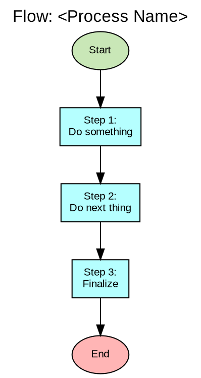

### Decision Flow

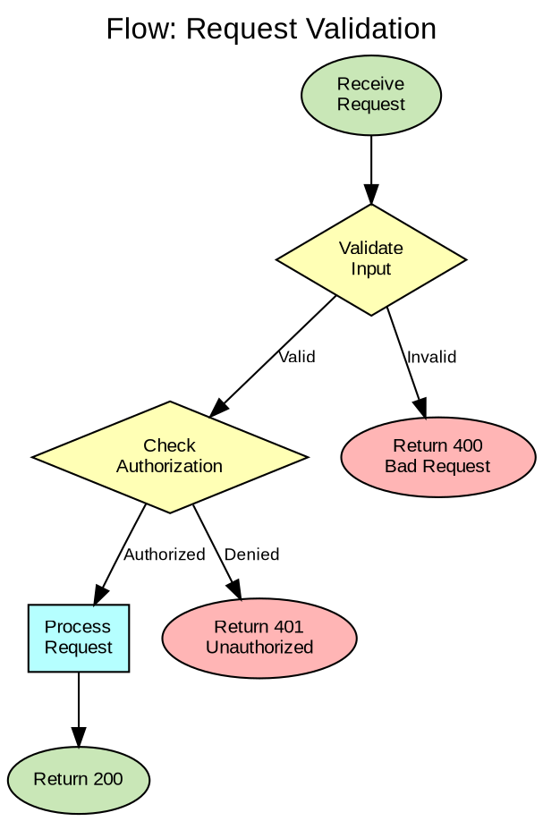

### Loop Flow

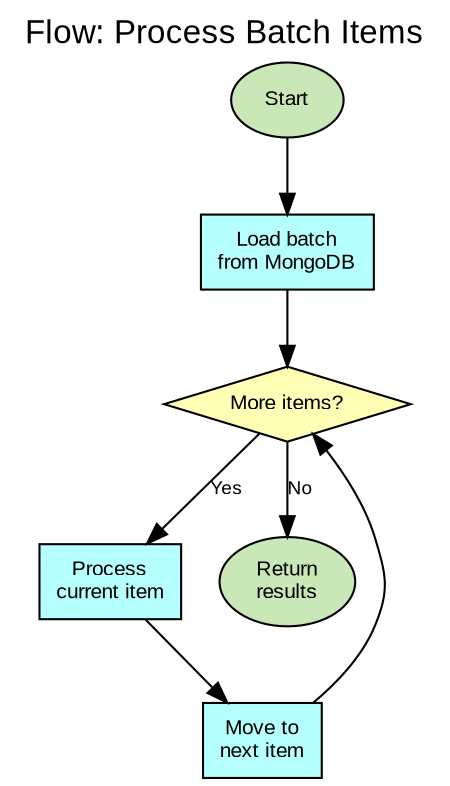

### Multi-Way Decision

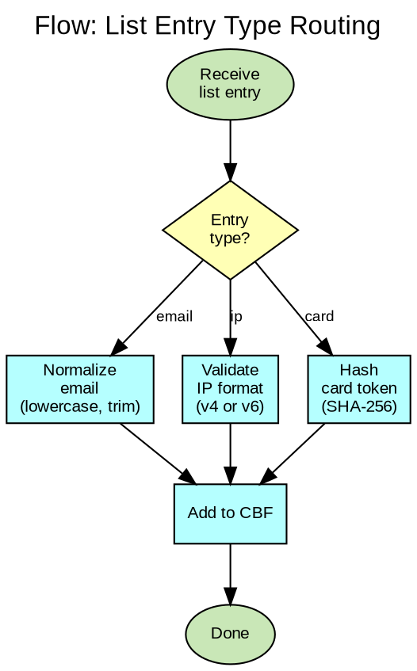

### Error Handling Flow (Go Pattern)

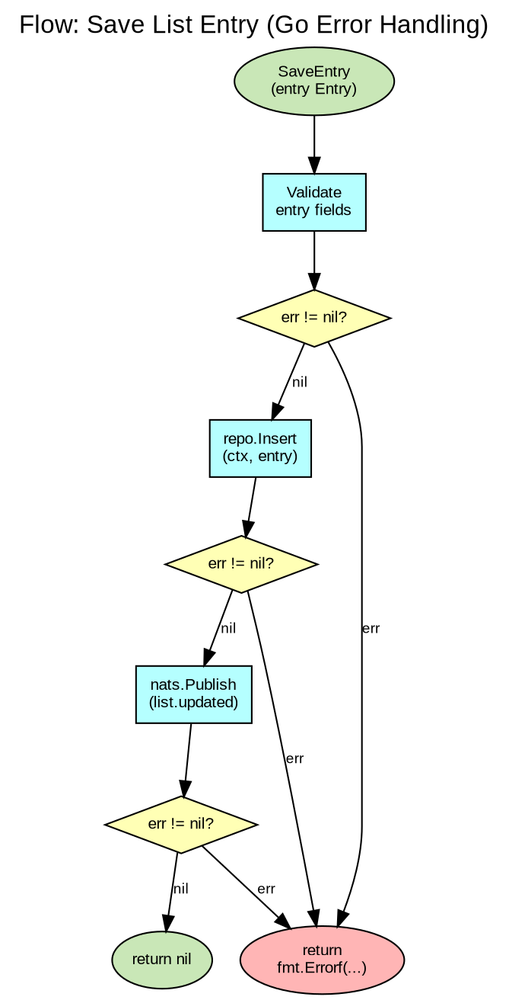

### Parallel / Fork-Join Flow

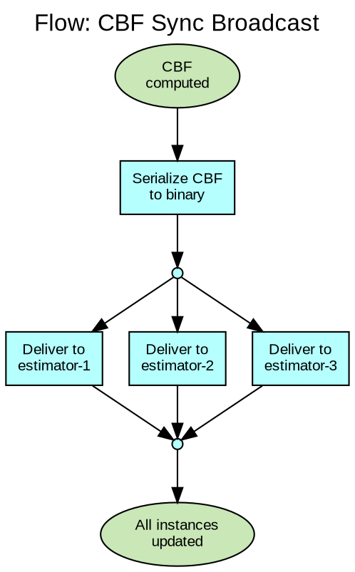
